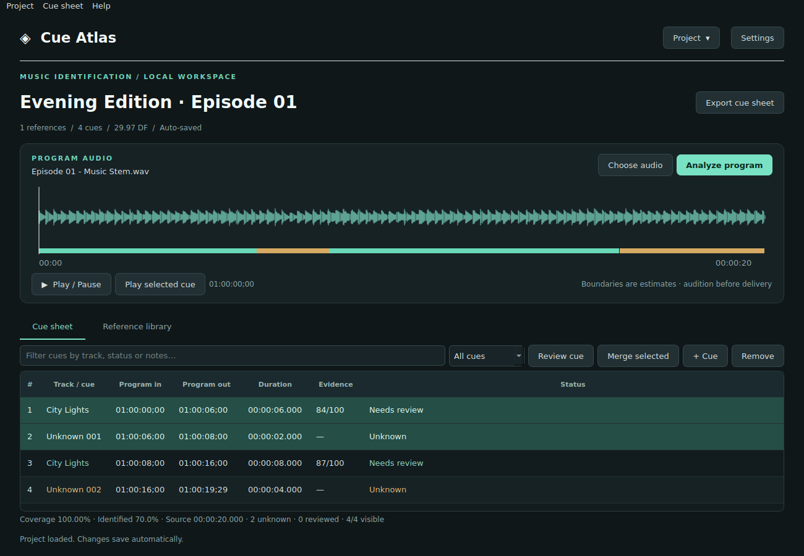

# Cue Atlas 0.6.5

Reference search filters cached metadata as you type, without rereading files or recalculating duplicates for each letter. Library changes refresh the search data.

Composer and publisher fields in the metadata editor accept normal typing, Backspace, and Delete. Clearing a field removes its matching Rights parties entries when you leave the field or Save. Other parties are retained; matching names keep their IPI and share details. You can also edit or remove individual rows in Rights parties. Save applies the changes; Cancel leaves the stored reference unchanged. PRO affiliations remain editable per party in Rights parties.


Credit lists split at commas, semicolons, new lines, and spaced slash separators outside parentheses or brackets. Slashes within names such as **Sony/ATV Songs LLC**, and affiliations such as **(SACEM/BIEM)**, stay intact. Combined affiliations are stored together in the party’s PRO field. Put names containing commas in double quotes when pasting a list, for example **"Smith, John" (PRS)**.

To repair a previously split list, open **Metadata → Edit selected reference → Rights parties → Paste credit lists…**. Paste the original composers and publishers into their separate fields, choose **Preview parties**, review the names and affiliations, then **Use these parties**. This replaces the editor’s party rows, including their IPI/share values. The reference updates only after you **Save** metadata; Cancel leaves the stored reference unchanged. Existing saved parties are never automatically reparsed.


The Reference library search sits between **Import library** and **Metadata**. Search matches reference metadata and file paths, regardless of letter case; clear the field to show all references. The count below the table shows visible and total references.

Click a column header in the cue sheet or Reference library to sort ascending; click again for descending. Times, durations, cue numbers, and evidence scores sort numerically. Sorting changes the view only; cue timing and reference assignments stay attached to their original entries. Cue numbers retain their original order; click **#** to restore chronological order.

Use the expand icon at the right of the Reference library toolbar, or **Library → Focus reference library**, to fill the workspace. Click the same icon to restore the waveform and tabs. Waveform, cue-sheet, and reference-library focus are mutually exclusive.


Version 0.6.2 compacts the Reference library into one toolbar row. **Metadata** groups Edit selected reference, Export metadata JSON, Import metadata JSON, and Recover embedded metadata, leaving more room for the track list.

Version 0.6.1 puts Import and Export metadata JSON together in the Reference library. The header and menu bar share an organized Project menu, with six recent projects and a full project browser featuring search, favorites, availability filters, and sorting. Project history no longer drops older entries after 12 projects.

Version 0.6.0 adds an editable licensing JSON round-trip: export reference metadata, make external corrections, preview old/new values, and import updates to existing references. The Help topic **JSON licensing round-trip** includes the format and examples.

Version 0.5.0 adds a live review queue, automatic recovery snapshots and restore, validation before export, editable keyboard shortcuts with conflict detection, saved timeline markers and comments, reference duplicate flags, and portable handoff packages. Existing project databases remain compatible.

## Review and delivery tools

| Tool | Where to find it | How it works |
| --- | --- | --- |
| Review queue | Header or Cue sheet menu; R for next | Unknown and unreviewed cues remain in the queue. Scores below the adjustable threshold (default 60) are flagged as weak. Reviewed and excluded assignments are omitted. |
| Recovery snapshots | Project → Recovery snapshots | Keeps the newest 20 dated database copies beside the project in `.cueatlas-snapshots`. Snapshots precede major project changes; routine cue edits use persistent Undo/Redo. Restore saves the current state first. |
| Cue-sheet validation | Cue sheet menu; Show warnings in export; before handoff | Flags missing composer/publisher, Unknown and unreviewed assignments, overlaps, and invalid timing. Timing errors block export; reviewing warnings is optional. |
| Custom shortcuts | Edit → Keyboard shortcuts | Reassign or clear editor keys, resolve conflicts, or restore defaults. App-wide menu shortcuts and row-selection keys are reserved. Help displays current editor bindings. |
| Marker comments | B; Cue sheet → Markers and comments | Save comments at exact program times, jump to them, edit, or delete. Timeline markers persist independently of cues; changes use recovery snapshots. |
| Duplicate detection | Library → Reference duplicates and alternate mixes | Exact file-checksum duplicates are skipped on import. Possible alternate mixes use similar base titles and need listening review; they are not verified audio matches. |
| Handoff package | Project → Create handoff package | Creates a new folder with the project, CSV cue sheet, validation report, markers, manifest, and optional media. Included media uses relative links. |

Snapshots contain the database and media links, not the media itself. Keep `.cueatlas-snapshots` beside the project to retain recovery history when moving it. A handoff starts a separate recovery history and does not include source recovery snapshots. Missing requested media is reported in the manifest. Media omitted from a handoff remains externally linked; send the full folder with its media subfolder to a recipient using Cue Atlas 0.5 or newer. Marker comments are included in `markers.json`.

Version 0.4.2 improves guide readability with larger text, generous line and paragraph spacing, and shorter sections under descriptive headings.

Version 0.4.1 adds a redesigned Help window with topic navigation, full-guide search, a shortcut reference, and What’s new. Open these directly from the Help menu.

Version 0.4.0 adds Left/Right frame stepping, Shift+Left/Right one-second steps, Home/End navigation, I/O marks and N to create a cue, F to identify, Enter to review, X to exclude/restore, Escape to cancel a drag or stop playback and clear selection/marks, and backslash to fit the whole program. These shortcuts work with the waveform or cue sheet focused and preserve normal text-field behavior. Frame stepping pauses playback. I/O marks appear as dashed lines; Out must be at least one frame after In. N creates and selects an Untitled cue, supports Undo/Redo, and clears the marks. Marks are temporary and reset on source/project changes. Restore with X from the Excluded view. On compact Mac keyboards, Fn+Left/Right produces Home/End.

Version 0.3.4 automatically fills the cue title from the chosen identification candidate when opening its review dialog. You can edit the title before saving; cancelling preserves the original cue.

Version 0.3.3 changes edit navigation to Down for next edit and Up for previous edit.

Version 0.3.2 accepts native arrow events carrying the keypad modifier and prevents edit navigation from sticking after media-clock rounding at fractional boundaries.

Version 0.3.1 fixes trackpad gesture-end events recentering the timeline and enables edit navigation from the cue table as well as the waveform.

Version 0.3.0 adds timeline edit navigation (Down: next edit; Up: previous edit), Q/W trimming of cue starts/ends to the playhead with Undo/Redo, and two-finger panning in either direction. Manual panning suspends playback follow until you seek or toggle Follow playhead. Command/Ctrl+scroll zooms. Cue trimming preserves all other cue positions.



A local Python desktop app for identifying reference music in a program and preparing a draft music cue sheet. Designed for macOS and PyCharm. No account or cloud recognition service is required.

## Put the project on your Mac

Extract the `CueAtlas` folder to:

```
/Users/editor/PycharmProjects/CueAtlas
```

Open that folder in PyCharm. Use Python 3.11 or newer (3.12 recommended), create a project virtual environment, install `requirements.txt`, and run `main.py`.

Or, in Terminal:

```bash
cd /Users/editor/PycharmProjects/CueAtlas
python3 -m venv .venv
source .venv/bin/activate
python -m pip install -r requirements.txt
python main.py
```

`Launch.command` performs the environment setup and launches the app. The first setup needs internet access to install dependencies. After installation, analysis is local. Original media is never uploaded.

## Make a standalone macOS app

Run `Build-Mac.command` on your Mac, or:

```bash
cd /Users/editor/PycharmProjects/CueAtlas
bash Build-Mac.command
```

The build script creates a fresh folder such as `dist/CueAtlas-0.3.2-XXXXXX` for each build, prints its path, and opens it in Finder. Copy `Cue Atlas.app` from that folder into Applications. Fresh output avoids failures removing previous builds. The resulting bundle includes Python, Qt, the matching engine, and the FFmpeg decoder, so an end user does not need Python installed. Build on Apple Silicon for Apple Silicon; build on Intel for Intel. This is a local unsigned app build, not a notarized public release.

The macOS app can be built locally with the script above. Test playback and keyboard/trackpad controls on your Mac after updating. The source folder and packaged app are separate: source changes appear in the packaged app only after rebuilding and launching the new bundle.

## Workflow

1. Choose **Project > New project**, name it, and save its `.cueatlas` file.
2. Open **Reference library** and add a music folder or individual files. Folders are scanned recursively. Identical unmodified paths are skipped on reimport.
3. Double-click a reference to review title, artist, composer, publisher, PRO, ISRC, ISWC, copyright, licensing, library, catalog, and notes. Original text tags remain available in a separate tab.
4. Choose program media: audio or MP4/MOV/MXF video. The first audio track is analyzed; video frames are ignored. Leading audio offsets are retained. Audio duration is checked against the selected audio stream, so a longer video tail does not cause a false incomplete-decode error. Files without audio report an error and preserve the project.
5. Set the program frame rate and starting timecode in **Project → Project settings**. Defaults are 29.97 DF and 01:00:00;00.
6. Select **Analyze**. A background task searches only this project's fingerprints, then refines timing against available reference waveforms.
7. Use the timeline and **Play** to audition. **Review cue** lets you adjust elapsed in/out, assign a reference, edit notes, and mark it reviewed. You can add or remove manual cues. To join adjacent cues, Shift-click adjoining rows (or Command/Ctrl-click), select **Merge selected**, choose the reference for the entire interval, and check the confirmation. The merged cue becomes Reviewed and retains the reference licensing metadata. **Edit > Undo** (Command/Ctrl-Z) restores the originals; **Redo** (Command/Ctrl-Shift-Z) reapplies the merge.
8. Export **CSV** or **Excel**. Exports include timing, duration, licensing fields, original metadata, evidence score, and review status.
9. Reopen the `.cueatlas` file, or select it from the **Project** recent menu to return to that project's work.

## Updating an existing installation

Quit Cue Atlas. Replace the `cueatlas` source folder and other source files in `/Users/editor/PycharmProjects/CueAtlas` with this version, keeping your `.venv`, audio, and `.cueatlas` project files. Existing project files are compatible; no fingerprint reimport is required. If you use the packaged Mac app, rerun `Build-Mac.command` and replace the old app bundle.

For a project whose cues end early, open it and choose **Cue sheet > Repair full-source coverage…**. This rereads the source, updates the program duration and waveform, and fills audible missing intervals while preserving existing reviewed cues and manual edits; silent intervals stay empty. New intervals are Unknown until reviewed or reanalyzed. Repair does not fingerprint the library again. If the underlying program file has changed since analysis, run a fresh analysis for that cut instead.

**Coverage** reports how much of the source has a cue row. **Identified** reports how much is assigned to references. A valid cue sheet can have 100% coverage with 60% identified music. Active table filters are labeled and reset to All cues when a project is opened, analyzed, or repaired.

Before saving analysis or repairs, the app compares decoded duration to source-reported duration (including sample-accurate PCM WAV data sizes). A substantial short decode raises an error and preserves the previous cues. Compressed/container duration can differ slightly because of rounding or encoder padding; a 0.25-second tolerance is used. When a container supplies no duration, decoded sample length is used. A damaged source whose metadata and decoded length both underreport its intended length cannot be reconstructed automatically.

## Responsiveness and detection presets

Version 0.6.9 extends batched column sizing to workflow dialogs and the project browser. An isolated 100-row dialog benchmark dropped from 120,000 cell measurements (0.99 seconds) to 300 (0.006 seconds). The review queue checks the database change version instead of reading every cue twice a second, while still detecting external commits and updated metadata/timecode. The matcher uses a moving window for local fingerprint support; an eight-track, 1,000-frame synthetic matching benchmark dropped from 0.32 to 0.012 seconds with identical results. These figures describe the measured operations, not total analysis time or every computer.

Version 0.6.7 also suspends automatic column sizing during table updates. A live trace of a slow deletion found roughly 24 seconds spent repeatedly measuring text as individual cells were replaced. Cue and reference tables now restore content sizing after the batch is complete.

Routine delete, merge, trim, and Undo operations refresh cue data without rebuilding the reference library, probing every reference file, or rereading the full Undo history for button labels. Routine cue edits never copy the full fingerprint database, even on the first edit or after an idle period. Only changed cue rows are written. Every cue edit and its Undo/Redo state are committed together immediately. Explicit snapshots, reanalysis, program replacement, and destructive reference operations retain forced full recovery checkpoints.

A synthetic benchmark with 2,000 references, 500,000 fingerprints, 300 cues, and a full 50-edit Undo history measured delete and merge, including cue interface refreshes, at approximately 0.11 seconds each with version 0.6.6. Those are local synthetic measurements, not a guarantee for every library or drive.

**Project > Project settings > Detection sensitivity** applies to full analysis and selected-cue identification:

| Preset | Fingerprint votes | Minimum supported duration | Supporting frames | Gap bridging |
| --- | ---: | ---: | ---: | ---: |
| Conservative (new default) | 24 | 3.0 s | 14 | 0.5 s |
| Balanced (previous default) | 12 | 2.0 s | 8 | 1.0 s |
| Sensitive | 8 | 0.75 s | 6 | 0.65 s |

Manual tuning selects Custom. Untouched legacy default thresholds adopt Conservative; custom thresholds are preserved. Presets require reanalysis for existing detections, or take effect on the next selected-cue retry. Settings do not rewrite existing cues automatically.

Audio-activity gating leaves silent stretches empty, trims/splits automatically detected regions across substantial silence, and avoids Unknown boundary slivers shorter than 0.25 seconds. New default silence gating is −65 dBFS; lower it to preserve quieter material. Short pauses and 50-ms boundary padding protect normal music phrasing/fades. This does not classify dialogue or effects as music: audible unmatched regions can still be Unknown. Existing reviewed/manual/excluded cues are preserved during coverage repair. Reanalyze to apply the new silence treatment to a prior analysis.

## Retrying and comparing a single cue

Select one cue and choose **Identify selected cue…** from **More**, the expanded waveform **Cues** menu, or the waveform right-click menu. This searches the exact saved in/out interval and presents candidate references. Choose **Review candidate** to open the matched reference with its title automatically filled into **Cue title**. Edit the title if needed, compare playback, then Save to accept; cancellation or no match leaves all cues and history unchanged. Original reference recordings are not needed for matching against stored fingerprints.

**Review cue** offers separate **Program cue** and **Reference** playback buttons with exclusive playback. Reference playback defaults to −12 dB relative to program playback. Set the project default in Project settings, or save a per-track override in Review. **Project default** clears that override. New analyses and accepted retries retain a reference-position estimate; older cues can be retried or positioned with **Reference in**. Assignment remains subject to review; set the status to Reviewed when confirmed.

Missing/changed originals disable reference playback and expose **Reconnect…**. The library Relink control and Library menu also reconnect a selected reference. Reconnect verifies content and keeps fingerprints, licensing metadata, and cues. Fingerprints cannot reconstruct playable reference audio. Playback is optional; offline identification and export still work.

AI dialogue/music separation has been assessed but is not installed/enabled. See [the implementation assessment](docs/source-separation.md) for model/runtime requirements, local processing, caching, and limitations.

## Projects and media

**Project > Browse projects…** opens a searchable list of recent and currently open projects. Use All projects, Favorites, or Unavailable; search by name or folder and sort by Recently opened or Name. Favorite projects for quick filtering. Add an existing project, open it, or open its folder. Rename, Backup, Remove from Recents, and Move to Trash are in **More**. The menu bar and header dropdown share the same Project menu; **Recent projects** shows the latest six, with **Browse all projects** for the full saved list. Project locations and missing/invalid files are visible. The project name is the `.cueatlas` filename without the extension. In-app renaming changes the filename in the same folder and updates Recents; renaming in Finder updates the name on opening, and same-folder Finder renames of the open project are detected automatically. Name collisions are rejected without overwriting another file. Backups take their name from their own filename.

**Remove from Recents** only hides the recent listing; the database and media remain untouched. An open project stays visible in the manager until closed. **Close project** clears the workspace without deleting the database. **Move to Trash…** confirms first and closes the selected project if it is open. Only its `.cueatlas` database moves; original recordings, other projects, and the app environment remain intact. Failed moves reopen the current project. Restore through Finder/your file manager, then reopen the `.cueatlas` file; cue Undo does not restore deleted projects. Backup files preserve cues, fingerprints, metadata, and media links, but do not copy original audio/video.

### Editing cues over the waveform

The workspace fits the app window with a resizable divider between waveform and cue sheet. Only the tables scroll through long lists. Expand/restore icons at the top right of each pane maximize that pane within the workspace. **Export cue sheet** stays at the top right, beside **Project**, in all layouts. Choose Media and Analyze are shown during setup; after setup they are available through **Program** in the menu bar or the program-header gear. Instructions and keyboard shortcuts are collected in **Help > User guide**.

With the waveform or cue sheet focused, **J / K / L** play backward, pause, or play forward from the current playhead. Repeat J or L for 2×, 4×, and 8×; changing direction returns to 1×. K leaves the playhead in place. Reverse playback uses audible, temporary 30-second PCM chunks at 44.1 kHz, cleaned up when finished; a brief preparation pause can occur between chunks. These keys do not intercept typing in text fields.

The transport shows **Playing** or **Paused** and the current mode: **Free playback**, **Preview: song title**, **Audition In/Out**, or **Loop In/Out**. The main Play button and Space follow the same mode. Selecting a different cue stops the old preview; clicking below the cues selects free playback from that cursor position.

The transport has one **Play** button, one contextual **Audition** button, and **Loop**. Click a cue edge to choose it: the audition button becomes **Audition In**, **Audition Out**, or **Audition edit** at a shared join. Press **A** with the waveform focused to audition the selected edge. **Loop** repeats that window; Space pauses/restarts it. The **⋯** menu contains explicit In/Out audition actions, one-frame adjustments, and **Seconds each side** (two seconds by default). With the waveform focused, **comma / period** nudges the selected edge back / forward one frame. Windows are clamped to the program edges. Seeking, editing, or changing selection cancels a loop.

**Edit > Undo** (Command-Z on macOS, Ctrl-Z elsewhere) and **Redo** (Command-Shift-Z / Ctrl-Shift-Z) share a history of the last 50 cue edits: trims, rolls, merges, reviews, additions, removals, exclusions, and restorations. History survives reopening the project. New edits discard the redo branch; navigation and playback do not add history. Text fields retain their own text undo. New analysis, coverage repair, program replacement, or reference removal resets cue history. Importing a reference library preserves it. Legacy project databases remain compatible; no schema migration is required.

**Program > Snap edits to playhead** enables magnetic snapping for cue edges and shared A/B/roll edits. It is on by default and remembers the app preference. Position the playhead at the intended edit, then drag near it; the edge locks to that exact cursor time and the playhead highlights green. Cursor snapping takes priority over the normal frame grid. Drag away to release, or disable the setting for normal frame-grid dragging. Capture distance is measured in screen pixels so it stays consistent across zoom levels; invalid/zero-length cues cannot be created by snapping.

Drag handles highlight on hover. A small movement threshold prevents click jitter from changing a boundary, and dragging keeps the edge at the position where you grabbed it. Cue lanes remain steady, and the preview matches the saved edit. Release saves one edit; Escape or Command/Ctrl-Z during an unfinished drag cancels that drag.

Editing follows the cursor; there is no edit-mode dropdown. At a shared join, hover just inside the **left cue** to trim its out point, just inside the **right cue** to trim its in point, or directly on the **join** to roll both sides. The handle highlight and hover label show which edit will happen. Rolling preserves the outer boundaries, reference assignments, notes, and licensing metadata. Single-sided trims leave the opposite cue unchanged, including Unknown cues, and may create empty space or an overlap. Cues must touch to start a roll. Release to save, press Escape during a drag to cancel, or use **Edit > Undo** afterward.

After analysis, the program waveform displays translucent colored regions labeled by song title. Overlapping cues occupy separate lanes. Click a region to select it; Shift-click selects a range, and Command/Ctrl-click toggles additional regions. Selection follows the cue sheet in both directions. Drag either edge to adjust its start or end on the project frame grid. Release to save, or press Escape during a drag to cancel. **Edit > Undo / Redo** traverses cue edits in order, including boundary trims and rolls. Neighbors retain their timings so crossfades can overlap. Trimming, reviewing, merging, and removing cues do not fill empty space with new Unknown cues.

Use **Command + / −** on macOS (**Ctrl + / −** elsewhere), the **+ / −** buttons, or the mouse wheel to zoom centered on the playhead cursor. Zoom returns to the playhead even after panning away; hovering the mouse elsewhere does not change the target. **Fit** fits the selected cues, or the whole program when nothing is selected; the **View** menu also offers both commands explicitly. Command/Ctrl with the unshifted equals key also zooms in. **View > Follow playhead** is on by default and remembers your preference. During playback, it pages ahead just before the playhead reaches the right edge, with a small overlap; reverse playback pages left. The zoom level is preserved. Paused navigation and cue dragging do not trigger automatic paging. Disable Follow playhead to hold the current view during playback. Two-finger trackpad scrolling in either direction pans the timeline without changing zoom; Shift+wheel and the horizontal scrollbar also pan. Manual panning suspends playback follow until you seek or toggle Follow playhead. Command/Ctrl+scroll zooms. Zooming loads finer peaks from the actual source audio in the background; keep the program audio available for detailed waveform display. Time ruler labels include the project's starting timecode. The cue regions sit above a separate waveform area. Click the waveform below the regions to deselect cues and position the playhead, including before a cue boundary. Press Space to play freely from there without stopping at cue boundaries; press again to pause. Selecting a cue restores playback from its start with a stop at its end.

**Q / W:** with the waveform focused and the playhead strictly inside a cue, Q trims its start to the playhead and W trims its end. Select the target if cues overlap. These edits preserve other cue positions and support Undo/Redo. A playhead in a gap or exactly on a boundary makes no trim.

**Hold Shift and drag** across the timeline to draw a new cue, in either direction. The outlined region previews its bounds; release saves one frame-snapped **Untitled cue**. Escape or Command/Ctrl-Z before release cancels the drawing. A Shift-click without dragging still selects a range of existing cues. Drawing can overlap existing cues without replacing them. Double-click the new cue to name it or assign a reference. Additions participate in Undo/Redo. Empty space remains empty when the project is reopened.

Click the **expand icon in the waveform header** for a larger editing workspace. The **Cues** menu and right-click menu contain Review, Merge, Exclude/Restore, Add, and Remove. Standard Undo/Redo lives in **Edit** and is available through keyboard shortcuts. Space previews the current cue from its head and pauses at its end; press Space during playback to pause. Press M to merge selected adjoining regions using the reference-confirmation dialog. Double-click a region to review it. **Excluded cues** switches to the excluded placeholders for restoration. The same icon becomes **Restore waveform**, returning the cue sheet below it. In the cue-sheet toolbar, **More** contains Add and Remove. Project settings are in **Project > Project settings**. Changes save automatically and appear in exports; edits affect cue timings, not the source audio.

**Delete cues:** select one or more cues in the cue sheet or timeline and press **Delete / Backspace**, then confirm. This works for excluded cues too: select the **Excluded** filter (or **Excluded cues** in expanded waveform view), select cues, and delete. **More** and the waveform right-click menu also offer **Delete selected cues…**. Deletion leaves empty space; **Edit > Undo** restores the cues and their excluded status, and Redo deletes them again. Source recordings and reference-library entries are preserved.

To omit a mistaken detection or non-music interval, select one or more cues and click **Exclude**. Excluded cues disappear from the normal cue views and are omitted from CSV and Excel exports. Their timings, reference assignments, review status, and notes remain saved. Choose **Excluded** in the cue filter, select the placeholders, and click **Restore** to bring them back. Excluded placeholders still represent source coverage and appear gray when viewing excluded cues on the timeline, so coverage repair does not replace them with Unknown cues. Exclusions and restorations participate in the shared Undo/Redo history. Running a new analysis replaces all cues and exclusions after confirmation; back up the project first to preserve them.

Click the **expand icon in the cue-sheet toolbar** to fill the available workspace with the cue sheet. Its restore icon returns the program waveform and reference library. You can also toggle this through **Cue sheet > Focus cue sheet** or Command+Shift+F on macOS (Ctrl+Shift+F elsewhere).

With the waveform or cue table focused, **Down** seeks to the next edit and **Up** to the previous edit. Use **Shift+Up/Down** in the cue table to select adjoining rows. Press **Space** to preview the current cue from its start; playback pauses at its end. Press Space during playback to pause, then press again to replay the selected cue. Press **M** with multiple adjoining cues selected to open the merge dialog, including its reference confirmation. These keys remain available in the normal layout too.

Each `.cueatlas` is a self-contained SQLite database of that project's fingerprints, imported metadata, configuration, waveform overview, and current cues. There is no global music database. You may run multiple app instances with different project files. Open a particular project in only one app instance at a time.

Changes save automatically. **Backup project** makes a consistent database copy. Backups do not include original media, so retain the audio separately. References and program audio are linked by absolute path.

To reuse references from a previous project, open the destination project and select **Reference library > Import library…** or **Library > Import reference library…**, then choose the previous `.cueatlas` file. This copies its indexed fingerprints and all reference metadata, including licensing and original tags, without reprocessing audio. The current program, cues, settings, and existing reference metadata are preserved. References with duplicate paths or matching stored content hashes are skipped. The source project is read-only during import, and cancellation rolls back the entire import. Media stays at its original path; missing files remain listed as Missing and can be relinked. Imported fingerprints can still identify music while reference media is offline, although waveform timing refinement requires the reference files. Reanalyze when you want the new references included in matching.

The reference table shows missing or changed media. **Relink** reconnects a reference only after checking its size and SHA-256 content fingerprint. A genuinely different recording should be imported as a new reference. Use **Program > Choose / relink audio or video** to relink or replace a missing program. When replacing a program, choose whether to keep existing cues for review or clear them. A new analysis replaces all current cues and manual edits after confirmation. Save a backup when retaining multiple cuts.

Completed reference imports survive cancellation. Cancelled or failed analysis preserves the previous cue list. Cancelling a long fingerprint calculation may wait until the current calculation completes. Background work must stop before switching or closing a project.

## Timing and detection

- Matches use spectral landmarks against the actual recordings you supply. No public Shazam-style catalog is queried.
- Multiple uses and overlapping references are supported. A waveform correlation pass improves fade boundaries when the original reference files are available.
- Boundary estimates are draft measurements, not guaranteed first/last audible frames. Very quiet tails, short stings, loops, alternate mixes, speed changes, and heavy processing may need manual work. Pitch/time-stretch invariant matching is not implemented.
- Analysis and the explicitly invoked full-source coverage repair add Unknown rows only for audible unmatched intervals. Silent gaps and tails remain empty. Existing Unknown cues remain available for review; manual edits never create replacement placeholders. An unknown interval may contain several songs, dialogue/effects, brief pauses, or an unrecognized part of a known track. It does not automatically identify internal unknown-song boundaries.
- Likely silent unknown intervals receive a note based on RMS level. The app does not claim to distinguish all music from dialogue or effects. It is intended first for a music-only program or isolated music stem.
- Evidence scores summarize fingerprint support. They are not statistically calibrated probabilities. All automatically identified cues begin as **Needs review**.
- Internal positions are elapsed seconds. Display/export timecodes use the selected project frame rate and origin. Out is exclusive. Drop-frame is supported at 29.97 and 59.94. Duration seconds are authoritative; the duration TC column is the elapsed duration represented in the selected timecode counting format.
- Audio-aware analysis/repair omit unmatched boundary fragments shorter than 0.25 seconds. Legacy `unknown_min` settings remain ignored. Manual edits and deletions leave newly uncovered intervals empty. A cue sheet may intentionally have less than 100% coverage. Full-source coverage repair explicitly fills audible gaps again; use it only when that is desired. Overlapping cues are retained; summed cue durations may exceed program duration, so coverage is calculated from the union of intervals.

## Metadata

Recover stored tags, edit structured rights parties, and import reviewed credits using the [metadata enrichment workflow](docs/metadata-enrichment.md).

Reads MP3/AIFF/WAV ID3 text tags via Mutagen, WAV RIFF INFO, BEXT description/originator fields, and iXML text. Common licensing fields are mapped to editable cue-sheet fields; unfamiliar embedded text is preserved in original metadata. Binary artwork is omitted. Vendor-specific, encrypted, nonstandard, or external licensing records may not map automatically. Missing licensing fields stay blank. The app does not invent writers, publishers, ownership shares, or license terms.

Imported tags are not verified clearance records. Exports contain what was imported or edited. Spreadsheet formula-like values in metadata are escaped on export.

## Settings

Settings are saved per project and include timecode, minimum cue length, fingerprint evidence threshold, gap bridging, and a silence gate and named sensitivity presets. Most users should start with defaults. Matching setting changes require reanalysis and are flagged in the main view.

## Development and verification

```bash
python -m pip install -r requirements.txt pytest
python -m pytest -q
```

The included tests cover project isolation and reopening, backups, metadata import, safe CSV export, SMPTE/drop-frame boundaries, compressed matching, repeated uses, unknown intervals, crossfades, cancellation preservation, merging/undo, continuous coverage, shortened decoding, non-destructive repair, and GUI project/dialog behavior. Fixtures are synthesized audio, not commercial music. A separate one-hour synthetic endurance run detected 360 expected track uses and verifies coverage through the final source sample. Real production material still needs a pilot test.

### Suggested next additions

- A/B program/reference audition with zoomed waveform and draggable frame-level cue handles.
- Multiple program versions inside one project, with cue comparison across cuts.
- Library-provided metadata CSV import and PRO/delivery-specific cue sheet templates.
- Additional channel selection for multichannel stems and dialogue-heavy mixes.
- Better unknown-music segmentation and alternate-mix matching, validated with real examples.

These are proposed follow-ups, not features currently shipped.


## Licensing JSON round-trip

1. Choose **Reference library → Metadata → Export metadata JSON…** or **Library → Metadata → Export metadata JSON…**.
2. Edit values in each track’s `metadata` object externally. Keep `reference_id` and `original_metadata` unchanged.
3. Choose **Reference library → Metadata → Import metadata JSON…**, select **Apply edits to existing references**, and review the Before / After preview.
4. Apply the changes. A recovery snapshot is saved first. Linked cues and subsequent CSV/Excel exports use the updated reference metadata automatically.

The UTF-8 document is an object with `format: "cueatlas.reference-metadata"`, `schema_version: 1`, and a `tracks` array. Each entry contains its exported `reference_id` and a `metadata` object. See [a copyable patch example](docs/reference-metadata-example.json); replace its sample ID with an actual exported ID.

Only supplied changed fields are updated. Omit a field to preserve it; use `""` to clear text. Text fields cannot be `null`. New exports include an `original_metadata` baseline so unedited values stay untouched and newer conflicting project edits are reported. Older/minimal patches without the baseline apply their supplied values after preview. Fill-only mode is also available and preserves existing information.

For structured rights credits, edit `metadata.parties`: each object has `role`, `name`, `pro`, `ipi` (text preserving leading zeros), and `share_percent` (0–100, or `null` for unknown). Allowed roles: composer, author, composer_author, arranger, publisher, subpublisher. Party edits regenerate composer/publisher/PRO summaries; leave those text summaries unchanged or omit them to avoid contradictory edits.

Imports match an existing `reference_id`, or when no ID is supplied, a unique provider/provider_track_id pair or exact absolute reference_file path. Titles and basenames alone never select a reference. Unmatched/stale/conflicting entries are reported. All previewed updates apply together, with metadata-source history. Original audio tags, fingerprints, cue timing, assignments, cue notes, and review status are preserved.

The readable in-app **Help → User guide → JSON licensing round-trip** topic lists every editable field and includes separate examples for simple licensing edits and structured writer/publisher credits.


## Timeline lasso selection

Click and drag from empty timeline space to select every visible cue touched by the selection box. Start below the cues on the waveform and drag upward to enclose them, or start in an empty cue-lane area. Command/Ctrl-drag adds to the current selection; Escape cancels and restores the previous selection. The cue sheet stays synchronized, so Merge, Exclude, and Delete apply to the selected cues. A simple click below the cues still deselects them and places the free-play cursor; Shift-drag still draws a new cue. Lasso selection does not change cue timings or add an Undo entry.


### Optional AI matching and cue splitting · 0.7.0

Install the optional local BandIt separation engine through **Project → Project settings → AI music separation** (Apple Silicon Macs, about 1.6 GB installed; 447 MB model plus runtime). Installation is explicit and needs internet access; subsequent processing is local. Normal analysis remains available without it. The model and runtime are stored separately under `~/Library/Application Support/CueAtlas/AI`, outside the app and project files.

Use **Reduce dialogue and retry** for selected cues, or **Cue sheet → Analyze all Unknown cues with separation** for a batch. Excluded cues are skipped; split intervals over five minutes first. Review original and separated candidates, audition both, and explicitly choose matches to apply. Applying marks results Needs review and joins touching cues with the same reference, including known neighbors. Gaps, excluded cues, and different references remain separate. The whole application is one Undo. Completed results survive cancellation and can be reopened from Cue sheet → Review last AI results. Setup includes Clear cached audio and Uninstall controls.

Select one cue and press **S** to split it at the playhead, or choose **Split cue at playhead** from a cue menu. Both pieces preserve reference/licensing, review state, notes, alignment, and exclusion. Undo/Redo restores exact intervals. The split point must be inside the selected cue. Shortcut bindings remain editable under Edit → Keyboard shortcuts.

### Installer startup fix · 0.7.1

The AI Install button now launches its worker correctly and displays “Starting installation…” immediately, followed by download and setup progress. Version 0.7.0 could fail before starting because its completion handler collided with Qt's built-in dialog `finished(int)` signal. No components were installed in that failure case. A regression test exercises the actual button click and completion path.


### Installation progress and settings access · 0.7.2

**Project → Project settings** is available before opening a project. It exposes AI music separation setup without creating a project or changing any project's settings. With a project open, the same menu retains the normal project controls.

The installer shows download bytes, totals, and percentages for Python and model downloads. Preparation, library installation, and verification use an animated activity indicator rather than a fixed percentage. Library installation displays the latest operation. Cancellation remains available throughout.


### Full-program AI analysis · 0.7.3

Click **Analyze** (or **Program → Analyze program**) and choose **Standard analysis** or **AI music separation**. The AI option processes the entire program before library matching, using the same installed optional engine as Unknown retries. Initial analysis no longer needs to find cues before separation can run. MP4/MOV audio uses the existing source-timeline decoder.

Separation runs in 60-second cores with four seconds of overlapping source context on each side, using one helper/model load for the run. Each core is placed at its original sample position; context is discarded rather than concatenated twice. Separated matching audio is downsampled into a program-length buffer, while waveform, audition, silence gating, reference boundary refinement, and exports retain the original audio and time base. AI-generated cues remain Needs review. The project records the analysis mode.

Completed sections are cached by source content, interval, model checksum, and processing version. Cache reuse is independent of matcher sensitivity. Disk space for pending inputs and outputs is checked before preparation. Cancel/errors preserve existing cues; successful reanalysis uses the existing confirmation and recovery snapshot behavior. The optional runtime remains outside the app and project databases.


### Standard + AI follow-up and recording-version review · 0.8.0

**Analyze → Standard + AI follow-up** searches the original mix first and applies the optional AI engine only to remaining Unknowns. Long initial Unknowns are bounded to two minutes; AI input includes up to four seconds of surrounding context on each side, cropped away before cue matching and audition. Known music and already identified version ambiguities are not separated again. The standard pass commits before follow-up; follow-up cancellation/failure keeps those results and completed proposals. AI proposals are applied explicitly through the results window, with one Undo for application and joins.

Candidate ranking retains original/AI evidence separately. A matching adjacent reference with a continuous source-to-reference offset supports a candidate, but cannot invent an audio match or select a version on its own. Automatic joins require the same reference ID, touching intervals, reference offsets agreeing within 0.12 seconds, and sufficient evidence across the selected interval. Partial evidence or gaps require boundary review instead of automatic joining.

Alternate recording hints normalize version suffixes/labels while preserving meaningful title text and rejecting conflicting provenance. Strong, distinguishing original-mix evidence takes priority within a proposed song family. Conflicting version evidence or ambiguous AI-only evidence defaults to an unassigned **Version needs review** proposal. Applying that default stores a Needs review cue and version choices without assigning a recording-specific license. A user can compare the candidate recordings, then explicitly assign the correct reference. Title-only alternatives are labeled Compare version and have no invented alignment. Each supported version retains its own reference position; reference level controls are unchanged.

Initial standard/full-AI searches also flag supported overlapping alternate-version observations. Version-review information survives project reopen and split, with Undo/Redo support. Licensing, reference paths, fingerprint records, and all individual recording metadata remain separate. The analysis dialog retains Standard analysis and Full-program AI separation as alternatives. The optional AI runtime and model are unchanged; no reinstall is required.

### Timeline AI listening · 0.9.0

Option/Alt-drag to mark a timeline range, use I/O marks, or select cues, then click **Separate range** above the waveform. Marked ranges take priority. Switch **Program audio / AI music** to compare at the same playhead position and zoom. The waveform follows the selected audio. Blue strips show separated coverage; outside those sections original audio plays with an explicit playback label. Existing full-program and cue-retry caches can be reused. Separation runs in a cancellable background worker and never edits cues, licensing, Undo history, or source media. The existing optional AI installation works without reinstalling. Derived timeline previews are removed by Clear cached audio.

### Editor controls · 0.9.1

Space controls playback instead of activating focused toolbar buttons, while text fields retain normal typing. Q/W trim or extend the selected cue start/end to the cursor; extensions preserve neighbors and support Undo. Option/Alt-I clears In, Option/Alt-O clears Out, and Option/Alt-X clears both marks. Unknown cues are yellow; identified references receive distinct colors, reused for each occurrence.

### Responsive comparison playback · 0.9.2

Review comparison prepares the requested program/reference interval in a background worker, then plays a disposable 48 kHz WAV from local temporary storage. Preparation can be cancelled, times out after 30 seconds, validates source size/mtime, and reuses the same interval within a review window. Closing review cancels without waiting for the decoder. Opening review does not eagerly load the full program again. Original media and fingerprints are preserved. The standalone app retains up to five local GUI-stall logs in `~/Library/Logs/CueAtlas`; these capture Python thread stacks after 15 seconds without a GUI heartbeat.
